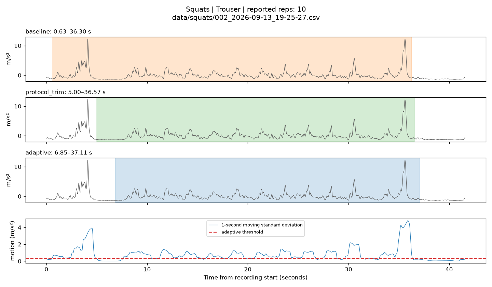
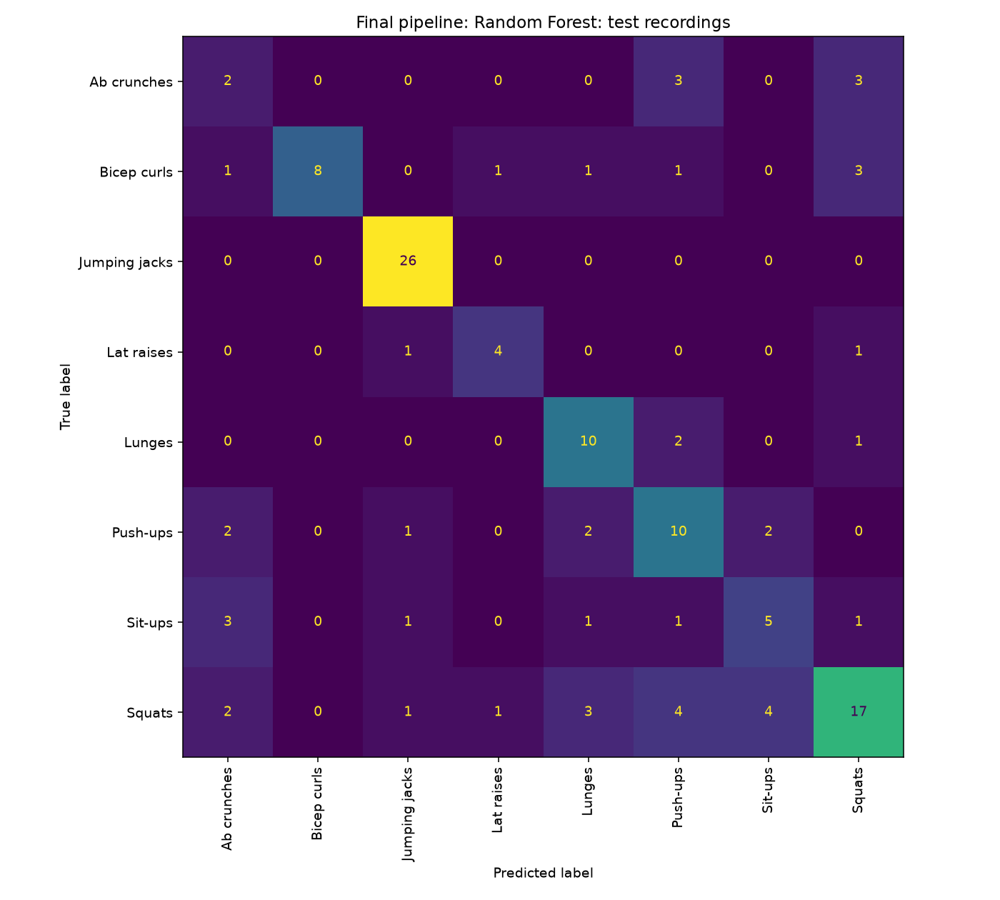
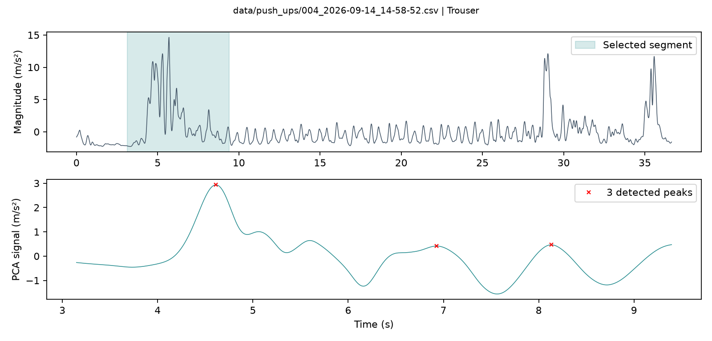
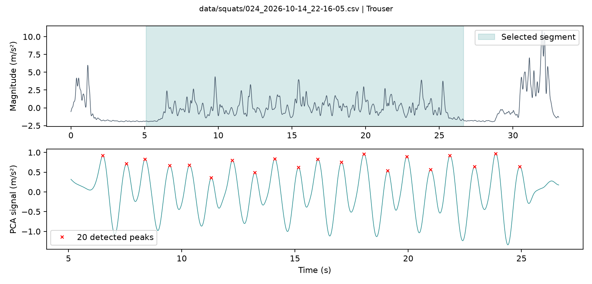

## Exercise recognition and rep counting

CS 328 | Assignment 3 | Exploration report

The final pipeline correctly classifies 82/129 test recordings (63.57%). Its rep-count MAE is 4.22, with 48.84% of recordings within two reported reps. The three design axes below were explored separately; better segmentation helps on average but can also remove the actual exercise set.

Evaluation protocol. The corpus has 430 recordings across eight exercises. The prescribed stratified recording split is 301 training / 129 test (random_state=42); training is split into 225 fit / 76 validation recordings. Counter settings were selected on fit data; features and models were selected using validation. Final classifiers were retrained on all 301 training recordings. No recording crosses splits. All test comparisons here are descriptive evaluations of frozen choices, not new tuning. MAE and within-two rates weight recordings equally; window accuracy weights windows equally. Rep labels are self-reported and may contain errors.

## 1. Segmentation exploration

| Approach | Key parameters | Test MAE | Within +/-2 |
| --- | --- | --- | --- |
| Whole recording | No trimming; diagnostic control | 5.14 | 37.98% |
| Fixed threshold | 1 s moving std > 0.5 m/s²; first to last active sample | 4.71 | 42.64% |
| Adaptive bouts | 1 s std; q10 + 0.20(q90-q10), floor 0.02; gaps <=2 s; bouts >=4 s; pad 0.75 s | 4.22 | 48.84% |
| Protocol trim | Remove 5 s at both ends; retain full trace if duration <=11 s | 4.25 | 53.49% |

Adaptive segmentation selects the longest surviving bout and falls back to the whole recording when none survives. It has the lowest test MAE (4.22 versus 4.71 for fixed threshold). Protocol trimming is essentially tied on MAE (4.25) and has a higher within-two rate (53.49%). This does not justify switching the development-selected method after seeing test results. Fixed threshold bridges distant handling bursts; protocol trimming assumes users followed the rest instructions; adaptive segmentation can miss low-amplitude reps or select sustained handling.

Classification effect (validation, fixed 100-tree forest, same 16 features and 6 s windows): adaptive 56.26%, baseline 53.35%, no segmentation 53.43%, protocol trim 54.91%. Adaptive improves on baseline by 2.91 percentage points, but the validation set is small and each segmentation changes the windows evaluated; these are pipeline comparisons, not paired identical-window tests.

Figure 1. Fit recording squats/002_2026-09-13_19-25-27.csv (Trouser, 10 reported reps). Baseline retains 0.63-36.30 s, including initial handling. Adaptive begins at 6.85 s, removing that burst, but still retains the large terminal burst.

## 2. Classification exploration

### Window length and feature design

| Window length | Validation windows | Baseline-feature accuracy |
| --- | --- | --- |
| 2 s | 1894 | 47.62% |
| 4 s | 887 | 48.93% |
| 6 s | 551 | 50.09% |

All windows use 50% overlap; segments shorter than a full window produce one shorter window. Six seconds was selected before model tuning because it gave the highest baseline-feature validation accuracy and usually captures several motion cycles. The 2.47-point difference between 2 s and 6 s is modest, rather than strong evidence of a universal optimum.

The seven baseline features describe filtered magnitude: mean, maximum, median, minimum, 25th percentile, 75th percentile, and standard deviation. Ten additions were tried; nine were kept. The table gives full 17-feature accuracy minus accuracy after removing that feature, in percentage points, using the same fixed forest. Effects depend on the other inputs and need not add together.

| Feature | Accuracy effect (pp) | Observed class recall effects | Rationale |
| --- | --- | --- | --- |
| std_x | -0.73 | Lat raises +4.00 recall points | Motion along x; sensitive to phone orientation |
| std_y | +1.45 | Push-ups +12.24; lunges +4.76 | Axis-specific motion amplitude |
| std_z | -0.73 | Lat raises +24.00; lunges -7.94 | Vertical/third-axis motion distribution |
| axis_dominance | +0.00 | Lat raises +8.00; squats -4.68 | Largest axis std / sum of axis stds |
| dominant_frequency | -1.63 | Lat raises +4.00; squats -5.85 | Largest-motion-axis FFT peak in 0.2-3 Hz |
| spectral_concentration | -0.54 | Lat raises +12.00; push-ups +8.16 | Peak-bin power / power in 0.2-3 Hz |
| corr_xy | +1.81 | Lunges +12.70; lat raises +12.00 | Coordination of x and y motion |
| corr_xz | -1.81 | Lunges -11.11; lat raises +12.00 | Tried and dropped; net validation decrease |
| corr_yz | -0.91 | Push-ups +12.24; sit-ups -8.11 | Coordination of y and z motion |
| rms_acceleration | +1.27 | Lat raises +16.00; bicep curls +5.26 | Root mean squared vector magnitude |

The baseline alone reaches 50.09%; axis motion 52.09%; rhythm alone 50.09%; correlations alone 53.54%; RMS alone 49.00%; axis + rhythm 55.35%; all ten additions 54.45%. Removing corr_xz gives the selected 16-feature set at 56.26%. Rhythm and axis features can help jointly even where individual removal effects are negative. Jumping jacks are already separable in the baseline, so the additions do not raise their validation recall in these ablations.

Fit-window medians support a physical interpretation: jumping jacks have RMS 26.38 m/s² and dominant frequency 1.33 Hz, versus squats at 2.36 m/s² and 0.67 Hz. Lat raises have corr_yz -0.38 versus squats +0.08. These are descriptive contrasts; placement variation and broad class overlap prevent universal thresholds.

### Models on the same frozen inputs

Both classifier types use adaptive segmentation, 6 s windows, and exactly the selected 16 features. Tree search: depths 3, 5, 8, 12, unlimited; gini/entropy; class_weight None/balanced. Forest search: 100/200 trees; depths unlimited/8/16; min_samples_leaf 1/3; class_weight None/balanced. All use random_state=42. Selection maximizes validation window accuracy, resolving exact ties by declared candidate order.

| Model | Key parameters | Validation window | Test window | Test recording |
| --- | --- | --- | --- | --- |
| Decision Tree | depth 12; gini; no class weights | 50.09% | 46.49% | 48.84% (63/129) |
| Random Forest | 200 trees; unlimited depth; leaf min 1; balanced | 56.62% | 60.43% | 63.57% (82/129) |

The forest was selected on validation, before test evaluation. Its test-window gain over the selected tree is 13.95 percentage points and recording gain is 14.73 points. Combining trees plausibly reduces dependence on a single set of thresholds, although the experiments do not isolate that mechanism. The default depth-5 entropy tree scores 48.43% on test windows, above the validation-selected tree; that observation does not reverse the selection. The default 100-tree forest scores 59.57%.

| Exercise | Tree window recall | Forest window recall | Change (pp) | Forest recording recall |
| --- | --- | --- | --- | --- |
| Ab crunches | 12.82% | 33.33% | +20.51 | 25.00% |
| Bicep curls | 37.90% | 45.16% | +7.26 | 53.33% |
| Jumping jacks | 88.73% | 98.59% | +9.86 | 100.00% |
| Lat raises | 33.33% | 58.97% | +25.64 | 66.67% |
| Lunges | 51.02% | 60.20% | +9.18 | 76.92% |
| Push-ups | 34.21% | 55.26% | +21.05 | 58.82% |
| Sit-ups | 21.57% | 42.16% | +20.59 | 41.67% |
| Squats | 46.23% | 60.00% | +13.77 | 53.12% |

Gains occur for every exercise at window level but vary substantially: lat raises +25.64 points and push-ups +21.05, versus bicep curls +7.26. Ab crunches remain weak despite improving by 20.51 points. Class imbalance and scarce minority examples remain limitations; balancing was evaluated, not assumed to solve the problem.

One unweighted vote per window gives one prediction per recording; exact ties resolve alphabetically. The forest improves from 60.43% window accuracy to 63.57% recording accuracy, but ordinary window accuracy gives longer recordings more influence. Mean within-recording window accuracy is 59.04%, so voting also improves the equal-recording-weight reference by 4.53 points. Eleven forest recordings have tied votes; only four ties resolve correctly. Voting can remove isolated errors but cannot repair consistently wrong windows.

## 3. Rep counting exploration

Every row below uses the final adaptive segmentation on all 129 test recordings. Parameters are the previously tried development candidates. Distance is a fixed number of seconds, not a fraction of an estimated period; prominence is a multiple of the filtered signal standard deviation. The baseline uses the prepared 5 Hz filtered magnitude; alternatives use second-order, zero-phase low-pass filtering before peak finding.

| Approach | Signal | Parameters | Test MAE | Within +/-2 |
| --- | --- | --- | --- | --- |
| baseline | Magnitude | 5 Hz; height > mean; distance >=1 s | 5.86 | 31.01% |
| magnitude_1Hz | Magnitude | 1 Hz; d=0.6 s; p=0.5 std | 6.39 | 31.01% |
| magnitude_1.5Hz | Magnitude | 1.5 Hz; d=0.6 s; p=0.5 std | 6.77 | 31.01% |
| axis_1Hz | Largest-std axis | 1 Hz; d=0.6 s; p=0.5 std | 5.03 | 44.96% |
| axis_1.5Hz | Largest-std axis | 1.5 Hz; d=0.6 s; p=0.5 std | 6.95 | 33.33% |
| pca_1Hz | First PCA direction | 1 Hz; d=0.6 s; p=0.5 std | 4.87 | 45.74% |
| pca_1.5Hz | First PCA direction | 1.5 Hz; d=0.6 s; p=0.5 std | 6.92 | 36.43% |
| Selected | First PCA direction | 1 Hz; d=0.6 s; p=1 std | 4.22 | 48.84% |
| pca_1Hz_distance0.9_prom0.5 | First PCA direction | 1 Hz; d=0.9 s; p=0.5 std | 4.59 | 44.19% |
| pca_1Hz_distance0.9_prom1 | First PCA direction | 1 Hz; d=0.9 s; p=1 std | 4.25 | 48.06% |
| pca_1Hz_distance1.2_prom0.5 | First PCA direction | 1 Hz; d=1.2 s; p=0.5 std | 4.92 | 37.21% |
| pca_1Hz_distance1.2_prom1 | First PCA direction | 1 Hz; d=1.2 s; p=1 std | 4.98 | 39.53% |

The selected PCA counter lowers MAE from 5.86 to 4.22 under the same adaptive segmentation, and raises within-two accuracy from 31.01% to 48.84%. Moving from 1.5 Hz to 1 Hz helps the axis/PCA variants by suppressing faster subcycles; increasing PCA prominence from 0.5 to 1 std at 0.6 s spacing lowers MAE from 4.87 to 4.22. Signal direction, filtering, and peak constraints work together; PCA alone is not the whole gain. The selected counter has a -1.16 rep bias, while the adaptive baseline overcounts by +1.15.

| Exercise | n | MAE | Within +/-2 |
| --- | --- | --- | --- |
| Ab crunches | 8 | 5.75 | 37.50% |
| Bicep curls | 15 | 4.13 | 40.00% |
| Jumping jacks | 26 | 3.88 | 61.54% |
| Lat raises | 6 | 6.00 | 33.33% |
| Lunges | 13 | 2.15 | 69.23% |
| Push-ups | 17 | 5.12 | 23.53% |
| Sit-ups | 12 | 3.42 | 50.00% |
| Squats | 32 | 4.47 | 53.12% |

Lat raises (MAE 6.00) and ab crunches (5.75) have the largest class MAEs; push-ups have the lowest within-two rate (23.53%). Weakly coupled placements reduce observable motion, while multiple acceleration cycles per rep can still cause overcounting. By placement: Hand n=59, MAE 3.49, within-two 55.93%; Trouser n=60, 4.70, 43.33%; Jacket n=6, 6.50, 33.33%; Armband n=4, 4.25, 50.00%. No bag/backpack recordings occur in test. Small placement groups and different exercise mixes limit comparisons.

## 4. Final pipeline and error attribution

Preprocessing: supplied preparation computes demeaned acceleration magnitude and applies a second-order 5 Hz zero-phase low-pass filter. Segmentation: adaptive 1 s moving magnitude std with threshold max(0.02, q10 + 0.20(q90-q10)); fill interior gaps <=2 s; discard bouts <4 s; retain longest bout with 0.75 s padding, or whole-recording fallback. The supplied cut helper also falls back if the cut is shorter than 1 s.

Classification: 6 s windows, 50% overlap; the seven baseline features plus std_x, std_y, std_z, axis_dominance, dominant_frequency, spectral_concentration, corr_xy, corr_yz, rms_acceleration. Dominant frequency uses a Hann-tapered FFT of the largest-std axis in 0.2-3 Hz. Model: RandomForestClassifier(n_estimators=200, max_depth=None, min_samples_leaf=1, class_weight="balanced", random_state=42), with other constructor defaults. Predict windows, then take the most frequent class with alphabetical tie resolution.

Rep counting: center x/y/z within the selected segment; second-order zero-phase 1 Hz low-pass each axis; project onto the first PCA direction with deterministic sign; count positive peaks at least 0.6 s apart and prominence >=1 signal std. Return zero if filtered signal std <0.01 m/s² or fewer than ten samples. These settings are common to every exercise; the exercise argument is unused, so counting does not depend on the true or predicted exercise label or phone-placement label.

Figure 2. Final recording-level test confusion matrix. Rows are true labels; columns are predictions. Total 129; diagonal total 82. Recording macro F1 = 0.591.

The following page accounts for every nonzero off-diagonal cell, including singletons. Attribution is diagnostic rather than a proven causal decomposition: there are no ground-truth set boundaries or interventions that uniquely identify the cause. Kept fraction is selected segment duration / recording duration; a very short fraction flags a possible segmentation failure, not proof. Feature-side explanations reflect motion/feature overlap; model-side evidence is strongest for documented voting ties.

### All nonzero recording-level confusions

| True to predicted | n | Median kept | Attribution | Likely mechanism (hypothesis) |
| --- | --- | --- | --- | --- |
| Ab crunches → Push-ups | 3 | 17% | Segmentation | Very short selected bouts may retain handling instead of weak torso motion. |
| Ab crunches → Squats | 3 | 64% | Feature side | Gravity-free torso/pocket motion lacks a reliable posture cue. |
| Bicep curls → Ab crunches | 1 | 100% | Feature side | Jacket motion is an indirect measure of arm flexion. |
| Bicep curls → Lat raises | 1 | 100% | Feature side | Both are arm movements with overlapping amplitude summaries. |
| Bicep curls → Lunges | 1 | 21% | Segmentation | Only 21% of this trouser recording is retained; much of the arm set may be absent. |
| Bicep curls → Push-ups | 1 | 90% | Feature side | Magnitude and direction summaries can overlap across placements. |
| Bicep curls → Squats | 3 | 91% | Feature side | Mixed phone orientation and cadence allow overlap with squat windows. |
| Lat raises → Jumping jacks | 1 | 57% | Feature side | Strong arm acceleration can resemble the arm phase of jumping jacks. |
| Lat raises → Squats | 1 | 9% | Segmentation | Only 9% is retained from a trouser recording; weak arm motion can be missed. |
| Lunges → Push-ups | 2 | 76% | Feature side | Cyclic motion summaries do not encode a unique body posture. |
| Lunges → Squats | 1 | 83% | Feature side | Both involve repeated leg flexion and similar pocket motion. |
| Push-ups → Ab crunches | 2 | 57% | Feature side | Trouser placement measures torso/pelvic motion in both exercises. |
| Push-ups → Jumping jacks | 1 | 100% | Feature side | Weak armband coupling gives unreliable class rhythm and intensity cues. |
| Push-ups → Lunges | 2 | 64% | Feature side | Trouser motion overlaps in amplitude and temporal summaries. |
| Push-ups → Sit-ups | 2 | 17% | Segmentation | Short selected bouts can discard the lower-amplitude exercise cycles. |
| Sit-ups → Ab crunches | 3 | 68% | Feature side | Similar torso flexion lacks posture information; one error also comes from a 1-1 vote tie. |
| Sit-ups → Jumping jacks | 1 | 100% | Feature side | The full trace is kept despite low global axis motion; summaries can be misleading. |
| Sit-ups → Lunges | 1 | 57% | Feature side | Repeated hand/torso movement can share the same amplitude and cadence features. |
| Sit-ups → Push-ups | 1 | 27% | Segmentation | Only 27% is retained, suggesting the selected bout misses much of the set. |
| Sit-ups → Squats | 1 | 93% | Feature side | The mostly retained trace still lacks an explicit lying/standing posture cue. |
| Squats → Ab crunches | 2 | 50% | Feature side | Relatively weak motion and gravity removal leave overlapping torso descriptors. |
| Squats → Jumping jacks | 1 | 73% | Feature side | High-amplitude hand movement can resemble a more vigorous exercise. |
| Squats → Lat raises | 1 | 96% | Feature side | Jacket movement reflects garment/phone dynamics as well as the exercise. |
| Squats → Lunges | 3 | 78% | Feature side | Closely related leg cycles share cadence and motion amplitude. |
| Squats → Push-ups | 4 | 72% | Feature side | Different placements can produce similar cyclic acceleration summaries. |
| Squats → Sit-ups | 4 | 84% | Feature side / model side | Torso summaries overlap; one documented 3-3 window tie resolves to sit-ups. |

Class scarcity may contribute to some model errors (especially six test lat-raise and eight ab-crunch recordings), but the matrix alone cannot demonstrate separable features followed by a faulty model boundary. Accordingly, most entries remain feature-side or segmentation hypotheses rather than confident model-side causal claims. All 47 errors are included above.

## 5. Top failure modes

### Failure 1: a handling bout replaces the exercise set

Specific test recording: data/push_ups/004_2026-09-14_14-58-52.csv, Trouser, 20 reported reps. The final segment is 3.14-9.40 s and produces only 3 peaks (error -17), the largest absolute final-counter error on test. The final classifier also predicts sit-ups for this recording.

Figure 3. The selected segment covers the initial large burst. Repeated lower-amplitude motion continues after the selected end; the lower panel shows the actual three detected PCA peaks.

Physical mechanism. Large early motion raises the recording-relative threshold, while weak pocket motion during push-ups fails to form the chosen sustained bout. The visible repeated motion around 10-28 s is excluded; its exact rep boundaries cannot be established from self-reported counts alone. The counter only sees the retained handling signal, so the downstream undercount is primarily a segmentation problem.

Specific change to evaluate on future development data: score candidate bouts using sustained periodicity as well as energy, allowing a lower-energy repeated set to outrank phone handling. This is a proposed improvement, not an implemented or test-tuned fix.

### Why this is more than a peak-threshold problem

Lowering prominence within the selected six-second fragment cannot restore the omitted set. This example separates an upstream boundary failure from a rep-counting failure within a correctly selected set. Conversely, squats have a positive mean count bias (+1.97), consistent with residual multiple cycles per reported rep; not every count error has the same cause.

### Failure 2: squats and sit-ups overlap, then voting breaks a tie

Specific test recording: data/squats/024_2026-10-14_22-16-05.csv, Trouser, 10 reported reps. The selected interval is 5.10-26.65 s. Three of six windows predict squats and three predict sit-ups, so alphabetical tie resolution outputs sit-ups. The final counter finds 20 peaks, illustrating that classification and count errors can coexist.

Figure 4. The selected segment includes the sustained central motion, with 20 detected PCA peaks. A plausible set interval does not guarantee unique exercise features or one peak per reported rep.

| Feature | Example median | Fit squats median | Fit sit-ups median |
| --- | --- | --- | --- |
| std | 1.107 | 1.082 | 1.443 |
| std_z | 1.816 | 1.191 | 1.687 |
| corr_xy | 0.229 | 0.041 | 0.230 |
| rms_acceleration | 2.562 | 2.361 | 2.904 |

Physical mechanism. A trouser phone measures cyclic pelvic/torso acceleration; after gravity removal, these features lack an explicit lying-versus-standing posture cue. The example corr_xy (0.229) is nearly the sit-up fit median (0.230), while magnitude std (1.107) is near the squat median (1.082), so different features support different classes. Class medians do not prove distribution overlap, but support the mixed-cue interpretation.

Attribution: feature side is the likely general limitation behind squats-to-sit-ups confusion (four recordings); model-side aggregation is the directly observed cause of this example’s final tied decision. Segmentation appears plausible in the trace, but no annotated boundary is available. A specific improvement is to compare probability-weighted voting against hard voting on development recordings; it may resolve conflicting-window ties but cannot guarantee better performance.

## 6. Contribution statement

Aditya Sathishkumar, Neal Patel, and Jayant Manem all contributed to the code and exploration report.

Evidence and reproducibility. Sections 1-3 use saved Step 2-5 development results and results/report_evidence test comparisons; Sections 4-5 use Step 6 recording predictions and the traces generated by report_evidence.py. Reproduce the new test counting tables with python3 report_evidence.py and rebuild this document with python3 build_exploration_report.py (reportlab required). Existing models, source methods, split files, and util.py were not modified to write this report.
